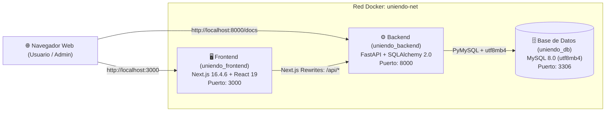

# 🐾 Uniendo Huellas (Conectando Huellas)

> Plataforma educativa para la adopción ética de animales de compañía rescatados. Conecta a personas interesadas en adoptar con refugios mediante un catálogo interactivo, seguimiento de solicitudes desde el perfil y herramientas de gestión administrativa. Los datos de muestra son ficticios; no implican verificación externa de organizaciones.

[](https://nextjs.org/)
[](https://react.dev/)
[](https://fastapi.tiangolo.com/)
[](https://www.python.org/)
[](https://www.mysql.com/)
[](https://docs.docker.com/compose/)
[](https://tailwindcss.com/)

---

## 📑 Tabla de Contenidos

- [🐾 Uniendo Huellas (Conectando Huellas)](#-uniendo-huellas-conectando-huellas)
  - [📑 Tabla de Contenidos](#-tabla-de-contenidos)
  - [🏛️ Arquitectura del Sistema](#️-arquitectura-del-sistema)
  - [🚀 Inicio Rápido con Docker Compose](#-inicio-rápido-con-docker-compose)
    - [Requisitos Previos](#requisitos-previos)
    - [1. Levantar todos los servicios](#1-levantar-todos-los-servicios)
    - [2. Acceder a las aplicaciones](#2-acceder-a-las-aplicaciones)
    - [3. Detener los servicios](#3-detener-los-servicios)
  - [🔑 Cuentas de Prueba Preconfiguradas](#-cuentas-de-prueba-preconfiguradas)
  - [🌟 Funcionalidades Principales](#-funcionalidades-principales)
  - [💻 Desarrollo Local sin Docker](#-desarrollo-local-sin-docker)
    - [Backend (FastAPI)](#backend-fastapi)
    - [Frontend (Next.js)](#frontend-nextjs)
  - [⚙️ Variables de Entorno](#️-variables-de-entorno)
  - [📡 Resumen de Endpoints de la API](#-resumen-de-endpoints-de-la-api)
  - [🛠️ Solución de Problemas Frecuentes (Troubleshooting)](#️-solución-de-problemas-frecuentes-troubleshooting)
  - [🤖 Documentación para Agentes de IA](#-documentación-para-agentes-de-ia)

---

## 🏛️ Arquitectura del Sistema

La solución está diseñada bajo una arquitectura moderna desacoplada en tres capas, orquestadas mediante Docker Compose dentro de la red aislada `uniendo-net`:



| Contenedor | Servicio | Imagen Base | Puerto Mapeado | Función Principal |
|---|---|---|---|---|
| `uniendo_frontend` | `frontend` | `node:20-alpine` | `3000:3000` | Aplicación web en Next.js (App Router, Tailwind CSS 4, AuthContext). |
| `uniendo_backend` | `backend` | `python:3.12-slim` | `8000:8000` | API REST en FastAPI, autenticación JWT y operaciones relacionales. |
| `uniendo_db` | `db` | `mysql:8.0` | `3306:3306` | Base de datos relacional `adopciones_db` con esquema y semillas iniciales. |

---

## 🚀 Inicio Rápido con Docker Compose

### Requisitos Previos
- [Docker Engine](https://docs.docker.com/engine/install/) (versión 24 o superior)
- [Docker Compose](https://docs.docker.com/compose/) (versión 2 o superior)

### 1. Levantar todos los servicios
Desde `programacion_web/Conectando-huellas`, ejecuta:

```bash
python3 scripts/configure_local.py
docker compose up -d --build
```

Docker descargará las imágenes base, compilará el backend y el frontend, levantará la base de datos MySQL inicializándola con el esquema y los datos de prueba (`schema_mysql_workbench.sql`), y arrancará la aplicación de manera automática.

Para comprobar el estado de los contenedores:
```bash
docker compose ps
```

Deberás ver los 3 contenedores en estado `Up`, con `db` y `backend` en `(healthy)`.

Si 3000 ya está ocupado, usa `python3 scripts/configure_local.py --port 3001`
antes del primer inicio, o cambia `FRONTEND_PORT` en el `.env` raíz existente.
El script no sobrescribe secretos ni configuración existentes. La clave JWT se genera
aleatoriamente; Compose no arranca sin ella. Cambiarla cierra las sesiones previas.
MySQL y backend están publicados solo en loopback; en Compose se deshabilita el
fallback a SQLite para evitar trabajar por error sobre otra base.

### Preparación para la revisión

Consulta [REVISION.md](REVISION.md) para ampliar los datos sin borrar volúmenes,
probar los flujos y conocer el alcance real de la demo. No uses `down -v` en una
instalación con información que quieras conservar.

### 2. Acceder a las aplicaciones

- **Portal Web (Frontend)**: [http://localhost:3000](http://localhost:3000)
- **Documentación Interactiva Swagger (Backend)**: [http://localhost:8000/docs](http://localhost:8000/docs)
- **Documentación ReDoc (Backend)**: [http://localhost:8000/redoc](http://localhost:8000/redoc)
- **Servidor MySQL**: `localhost:3306` (Usuario: `root`, Contraseña: `root`, BD: `adopciones_db`)

### 3. Detener los servicios

```bash
# Detener contenedores manteniendo los datos
docker compose down

# Detener contenedores y eliminar el volumen de la base de datos (reinicio limpio)
docker compose down -v
```

---

## 🔑 Cuentas de Prueba Preconfiguradas

En una instalación nueva, las semillas incluyen cuentas de demostración de usuario y encargado. No hay administrador ni contraseña administrativa predeterminados. Si vaciaste `usuarios`, estas cuentas de demostración ya no estarán disponibles.

| Rol | Correo Electrónico | Contraseña | Destino tras Login | Permisos y Capacidades |
|---|---|---|---|---|
| **Administrador** | Aprovisionamiento local | Personalizada o aleatoria | `/admin` | Gestión en `/admin` y perfil personal en `/perfil`; no solicita adopciones ni guarda favoritos. |
| **Encargado de Refugio** | `maria@huellitasconamor.org` | `refugio123` | `/perfil` | Perfil personal; conserva las operaciones de API limitadas a su refugio. No tiene acceso al portal `/admin`. |
| **Usuario** | `jesus@ejemplo.com` | `adoptante123` | `/perfil` | Catálogo, adopciones, favoritos y voluntariado en la misma cuenta. |

> [!TIP]
> Estas credenciales son exclusivamente de desarrollo. No hay accesos automáticos ni botones que cambien la sesión a una cuenta administrativa.

### Crear o recuperar el administrador

Solo quien tenga acceso al contenedor/servidor debe ejecutar este aprovisionamiento explícito:

```bash
docker compose exec backend python provision_admin.py \
  --correo admin@example.com --nombre "Administrador" --telefono 0000000000
```

La contraseña se solicita sin mostrarla. Para generar una aleatoria, agrega `--generate-password`: se mostrará una sola vez al crear la cuenta. Guárdala en un gestor de contraseñas, no en este repositorio. El comando guarda únicamente su hash bcrypt y rechaza correos existentes: no eleva permisos ni sobrescribe contraseñas de otras cuentas.

No se crean administradores automáticamente al arrancar ni desde el registro público. Si vuelves a truncar `usuarios`, el administrador también se elimina: ejecuta de nuevo el comando con un correo disponible. Conserva respaldos de la base de datos.

---

## 🌟 Funcionalidades Principales

1. **Catálogo Público de Mascotas (`/mascotas`)**:
   - Búsqueda en tiempo real por texto libre (nombre, raza, características, palabras clave como *juguetón*, *pequeño*).
   - Filtros combinados por especie (Perro, Gato, Otro), tamaño (Pequeño, Mediano, Grande), ubicación/ciudad y accesos directos por chips.
   - Peticiones vivas a la base de datos a través de `/api/consultas-juntas/catalogo`.

2. **Ficha Detallada de Adopción (`/mascotas/[id]`)**:
   - Información completa de la mascota, historia de rescate, edad estimada, cuidados veterinarios y datos de contacto del refugio.
   - **Postulación formal**: Vivienda, experiencia, teléfono y mensaje propio obligatorios (`POST /api/solicitudes`). La resolución se consulta en `/perfil?tab=solicitudes`; las notas internas no se publican.
   - **Botón de Favoritos**: Alternador de corazón conectado con la API (`POST/DELETE /api/favoritos`).

3. **Autenticación y Sesión Segura**:
   - Autenticación mediante **JSON Web Tokens (JWT Bearer)** con expiración configurable.
   - Manejo de sesión persistente en el frontend mediante `AuthContext` y validación automática al cargar contra `/api/auth/me`.
     - Registro público sin selector de rol (`/registro`): crea un **Usuario**, con ciudad o región de texto libre.
    - Contraseñas nuevas de al menos 8 caracteres, hasta 72 bytes UTF-8 por el límite de bcrypt. Las cuentas existentes pueden seguir iniciando sesión.
     - `/login` y `/registro` redirigen al inicio para usuarios normales y a `/admin` para administradores. Google y Apple no están habilitados.

4. **Portal del Refugio y Administración (`/admin`, exclusivo de administradores)**:
   - **Refugios**: Crear organizaciones, editar nombre/dirección/ubicación/teléfono y suspender o reactivar con confirmación. No crea cuentas de encargado. Incluye búsqueda sin tildes y filtro por estado.
   - Los refugios activos aparecen en el directorio y en **Nuevo Ingreso**. Suspender oculta sus animales del catálogo y bloquea nuevas adopciones, colaboraciones e ingresos, sin borrar animales ni historiales. Las fichas existentes siguen siendo editables desde administración.
   - **Métricas en Vivo**: Conteo global de animales en refugio, adopciones completadas, solicitudes pendientes y refugios activos.
   - **Inventario de Animales**: Tabla completa con buscador, filtro de estado y modal para **Nuevo Ingreso** con guardado directo en MySQL.
    - **Gestión de Solicitudes**: Revisión de postulaciones recibidas, visualización de datos de vivienda/contacto y acciones para **Aprobar** o **Rechazar**.
    - **Casos urgentes**: submenú del inventario y filtro combinable con estado y búsqueda. La urgencia se marca explícitamente al ingresar una mascota o con **Marcar urgente / Quitar urgencia**; no se deduce de su descripción ni de estar «en proceso».
    - **Nuevo ingreso**: refugio, datos del animal, descripción opcional, urgencia e imagen opcional; botón **Guardar**. «Ubicación / Pabellón» fue reemplazado por descripción, porque antes solo se concatenaba al texto público.
    - El administrador autenticado navega solo entre `/admin` y `/perfil`; las rutas públicas lo devuelven al panel. El cierre de sesión permite volver al sitio público.

5. **Perfil personal (`/perfil`)**:
   - Datos personales y enlaces directos: `?tab=favoritos`, `?tab=solicitudes` y `?tab=voluntariado`. La sección se conserva al recargar y al volver de una ficha.
   - **Favoritos guardados**: Una sola acción de quitar por tarjeta, sin tapar el refugio ni el enlace. Espera confirmación del servidor y conserva la tarjeta si falla.
   - **Mis solicitudes**: Historial de resoluciones definitivas; se consulta al abrir el perfil, sin prometer actualización en tiempo real.
   - Carga, error y lista vacía diferenciados; cada sección permite reintentar sin recargar las otras.
     - Cualquier **Usuario** (`id_rol=3`) puede usar **Mi voluntariado**: solicitud a un refugio activo para paseos, traslados o acogida temporal, disponibilidad y comentarios. El administrador aprueba o rechaza en `/admin` → **Voluntariado**.
     - Adopciones y voluntariado son funciones de la misma cuenta, sin permisos administrativos.
    - El perfil de gestión (administrador o encargado) muestra datos personales y cierre de sesión, sin favoritos, solicitudes personales ni contador de trámites. El encargado no obtiene acceso a `/admin`: conserva únicamente sus operaciones de API sobre su refugio.

El tema claro/oscuro sigue al sistema inicialmente y conserva la elección incluso
al cerrar sesión. Búsquedas sin depender de tildes y filtros guardados en la URL.

### Imágenes de mascotas

El formulario permite elegir JPG, PNG o WebP de hasta **5 MB y 20 megapíxeles**, con vista previa y opción de quitar la imagen. El servidor comprueba el contenido real, rechaza imágenes corruptas/animadas, corrige la orientación y convierte a JPEG de hasta 1600 px, eliminando metadatos privados.

Las imágenes se guardan en el volumen Docker **`animal_images`**, montado en `/app/uploads`, y se sirven mediante `/api/imagenes/{nombre}` a través del proxy de Next.js. Se conservan al reiniciar o reconstruir contenedores. No deben guardarse en Git; al respaldar la aplicación incluye tanto `mysql_data` como `animal_images`.

Si no se selecciona una foto, se guarda una URL ilustrativa elegida por especie. No cambia aleatoriamente al recargar. Una subida inválida no crea la mascota; si falla la BD se retira su archivo. Al eliminar una mascota se retira la imagen subida cuando ya no tiene referencias.

### Migración y pruebas

Al arrancar, el backend asegura `usuarios.ciudad`, `solicitudes_voluntariado` y `animales.es_urgente` (por defecto falso para registros existentes, sin inventar prioridades). La migración unifica los roles antiguos: todas las cuentas del rol 4 pasan al rol 3 (**Usuario**) y después se elimina únicamente el rol obsoleto. Conserva identificadores, contraseñas, favoritos y solicitudes. Es idempotente y no requiere borrar el volumen ni recrear cuentas.

Después de actualizar el código:

```bash
docker compose up -d --build backend frontend
```

Pruebas de API aisladas en SQLite en memoria (no modifican MySQL):

Consulta [VERIFICACION.md](VERIFICACION.md) para ver la cobertura y los flujos revisados con Playwright.

```bash
docker compose exec backend pip install -r requirements-dev.txt
docker compose exec backend python -m unittest discover -s tests -v
```

Frontend:

```bash
cd uniendoHuellas
npm run lint
npx tsc --noEmit
npm run build
npx playwright install chromium
npm run test:e2e
```

La suite E2E necesita la aplicación actual ejecutándose en `http://localhost:3001`
(`E2E_BASE_URL` permite otro origen). Intercepta todas las llamadas `/api/*`, sin
usar credenciales ni modificar MySQL. Ejecuta los recorridos del perfil en escritorio
y móvil, en claro y oscuro. Consulta [VERIFICACION.md](VERIFICACION.md).

---

## 💻 Desarrollo Local sin Docker

Si prefieres ejecutar los componentes de manera independiente en tu máquina de desarrollo:

### Backend (FastAPI)

1. Entra a la carpeta del backend:
   ```bash
   cd backendUniendoHuellas
   ```
2. Crea y activa un entorno virtual de Python:
   ```bash
   python3 -m venv .venv
   source .venv/bin/activate  # En Linux / macOS
   # .venv\Scripts\activate   # En Windows PowerShell
   ```
3. Instala las dependencias:
   ```bash
   pip install -r requirements.txt
   ```
4. Configura el archivo `.env` (puedes basarte en `.env.example`):
   ```env
   DB_HOST=localhost
   DB_PORT=3306
   DB_USER=root
   DB_PASSWORD=root
   DB_NAME=adopciones_db
   USE_SQLITE_FALLBACK=true
   JWT_SECRET=<generar-un-secreto-aleatorio-de-al-menos-32-caracteres>
   ALLOWED_ORIGINS=http://localhost:3000,http://127.0.0.1:3000
   ```
   > **Nota:** Si no dispones de un servidor MySQL local, el backend conmuta automáticamente a la base de datos SQLite local (`adopciones.db`) para que puedas desarrollar sin interrupciones.
5. Inicia el servidor de desarrollo:
   ```bash
   uvicorn main:app --reload --port 8000
   ```

### Frontend (Next.js)

1. Entra a la carpeta del frontend:
   ```bash
   cd uniendoHuellas
   ```
2. Instala las dependencias de Node.js:
   ```bash
   npm install
   ```
3. Inicia el servidor de desarrollo con Turbopack:
   ```bash
   npm run dev
   ```
4. Abre [http://localhost:3000](http://localhost:3000) en tu navegador.

---

## ⚙️ Variables de Entorno

| Variable | Descripción | Valor por Defecto (Docker) | Ámbito |
|---|---|---|---|
| `DB_HOST` | Host del servidor de base de datos | `db` | Backend |
| `DB_PORT` | Puerto de conexión a la base de datos | `3306` | Backend |
| `DB_USER` | Usuario de MySQL | `root` | Backend / DB |
| `DB_PASSWORD` | Contraseña de MySQL | `root` | Backend / DB |
| `DB_NAME` | Nombre de la base de datos | `adopciones_db` | Backend / DB |
| `DATABASE_URL` | Cadena de conexión SQLAlchemy (PyMySQL) | `mysql+pymysql://root:root@db:3306/adopciones_db?charset=utf8mb4` | Backend |
| `USE_SQLITE_FALLBACK` | Conmutar a SQLite (`adopciones.db`) si MySQL falla | `true` | Backend |
| `ALLOWED_ORIGINS` | Orígenes HTTP permitidos en CORS | `http://localhost:3000,http://127.0.0.1:3000,http://frontend:3000` | Backend |
| `JWT_SECRET` | Clave secreta para firmar tokens JWT | Obligatoria, aleatoria; sin valor predeterminado | Backend |
| `ACCESS_TOKEN_EXPIRE_MINUTES` | Duración del token de sesión | `1440` (24 horas) | Backend |
| `INTERNAL_API_URL` | URL del backend accesible internamente por Next.js rewrites | `http://backend:8000` | Frontend |
| — | El navegador consume rutas relativas `/api/...`; no requiere `NEXT_PUBLIC_API_URL`. | Mismo origen | Frontend |

---

## 📡 Resumen de Endpoints de la API

| Método | Endpoint | Descripción | Requiere Autenticación |
|---|---|---|---|
| `GET` | `/` | Estado de la API y motor de base de datos conectado | No |
| `POST` | `/api/auth/register` | Crea un Usuario; no acepta `tipo_cuenta` ni `id_rol`; `ciudad` libre | No |
| `POST` | `/api/auth/login` | Inicio de sesión (retorna token JWT + datos de usuario) | No |
| `GET` | `/api/auth/me` | Información del usuario en sesión actual | Sí (Bearer) |
| `GET` | `/api/consultas-juntas/catalogo` | Catálogo público con filtros avanzados de búsqueda | No |
| `GET` | `/api/consultas-juntas/dashboard` | Métricas y estadísticas consolidadas de la plataforma | Sí (Admin) |
| `GET` | `/api/consultas-juntas/refugios-directorio` | Directorio de refugios activos y conteo de animales | No |
| `GET` | `/api/refugios/gestion` | Todos los refugios y conteo total de animales, incluidos inactivos | Sí (Admin) |
| `POST` | `/api/refugios` | Crear una organización, sin crear usuarios | Sí (Admin) |
| `PUT` | `/api/refugios/{id}` | Editar contacto; solo Admin cambia `estado_cuenta` | Sí (Admin / encargado del propio refugio) |
| `DELETE` | `/api/refugios/{id}` | Solo refugios vacíos; con registros vinculados devuelve 409 | Sí (Admin) |
| `GET` | `/api/animales` | Listado general de animales con paginación y filtros | No |
| `GET` | `/api/animales/{id}` | Datos básicos de un animal por su identificador | No |
| `GET` | `/api/animales/{id}/detalle-completo` | Detalle del animal con refugio, estado de favorito y solicitudes | Opcional |
| `POST` | `/api/animales` | Dar de alta una nueva mascota en el catálogo | Sí (Refugio / Admin) |
| `POST` | `/api/animales/ingreso` | Alta multipart: `datos` (JSON serializado), `foto` opcional | Sí (Admin) |
| `GET` | `/api/imagenes/{nombre}` | Imagen pública validada de una mascota | No |
| `PUT` | `/api/animales/{id}` | Editar información o estado de una mascota | Sí (Refugio / Admin) |
| `DELETE` | `/api/animales/{id}` | Eliminar registro de una mascota | Sí (Refugio / Admin) |
| `GET` | `/api/solicitudes` | Listar solicitudes de adopción registradas | Sí (Refugio / Admin) |
| `POST` | `/api/solicitudes` | Enviar una nueva postulación de adopción | Sí (Adoptante) |
| `PUT` | `/api/solicitudes/{id}/estado` | Aprobar o rechazar una postulación (`aprobada`, `rechazada`) | Sí (Refugio / Admin) |
| `GET` | `/api/solicitudes/relacion/mis-solicitudes` | Solicitudes enviadas por el usuario autenticado | Sí (Adoptante) |
| `GET` | `/api/favoritos/relacion/mis-favoritos` | Mascotas guardadas en favoritos por el usuario actual | Sí (Adoptante) |
| `POST` | `/api/favoritos` | Agregar una mascota a favoritos | Sí (Adoptante) |
| `DELETE` | `/api/favoritos/animal/{id_animal}` | Quitar una mascota de favoritos | Sí (Adoptante) |
| `GET` | `/api/favoritos/verificar/{id_animal}` | Comprobar si una mascota está en favoritos (`{ es_favorito: bool }`) | Sí (Adoptante) |
| `POST` | `/api/voluntariado` | Solicitar colaboración; una solicitud por usuario/refugio/modalidad | Sí (Usuario) |
| `GET` | `/api/voluntariado/mis-solicitudes` | Consultar únicamente las solicitudes propias | Sí (Usuario) |
| `GET` | `/api/voluntariado` | Revisar todas las solicitudes con datos de contacto | Sí (Admin) |
| `PATCH` | `/api/voluntariado/{id}/estado` | Resolver una solicitud pendiente (`aprobada`, `rechazada`) | Sí (Admin) |

El mismo Usuario utiliza favoritos, adopciones y voluntariado. Los datos de usuarios, el historial detallado de adopciones y las métricas globales no son públicos. Los errores 422 no devuelven contraseñas ni valores de entrada.

El alta pública antigua `/api/auth/register-refugio` fue retirada (404). Las nuevas
organizaciones se registran desde **Administración → Refugios → Añadir refugio**,
sin crear cuentas adicionales. El panel no ofrece borrado de refugios.

Solo el rol Usuario puede crear adopciones/favoritos o consultar sus vistas personales. El personal mantiene las consultas de revisión administrativa. Catálogo e inventario aceptan `es_urgente=true|false`; `PUT /api/animales/{id}` permite cambiarlo a personal autorizado.

Consulta la documentación interactiva en **[http://localhost:8000/docs](http://localhost:8000/docs)** para inspeccionar esquemas JSON interactivos y probar los endpoints.

---

## 🛠️ Solución de Problemas Frecuentes (Troubleshooting)

### 1. Los caracteres con acentos o la letra ñ se visualizan incorrectamente
- **Solución**: Asegúrate de que MySQL y la conexión operen bajo `utf8mb4`. En `docker-compose.yml`, el servicio `db` ya incluye el parámetro `command: --character-set-server=utf8mb4 --collation-server=utf8mb4_unicode_ci` y los scripts SQL inician con `SET NAMES utf8mb4;`.

### 2. Error de puerto ocupado (`bind: address already in use`)
- Si los puertos `3000`, `8000` o `3306` están siendo utilizados por procesos locales (como otro servidor MySQL o Next.js en ejecución):
  ```bash
  # En Linux para verificar el proceso ocupante:
  sudo lsof -i :3000
  sudo lsof -i :8000
  sudo lsof -i :3306
  ```
  Detén los servicios locales antes de levantar Docker Compose, o modifica los puertos mapeados en la sección `ports:` de `docker-compose.yml`.

### 3. Reiniciar la base de datos desde cero con datos limpios
- Para borrar completamente el volumen de MySQL y reiniciar con el script de semillas:
  ```bash
  docker compose down -v
  docker compose up -d --build
  ```

---

## 🤖 Documentación para Agentes de IA

Si eres un asistente autónomo, modelo de lenguaje (LLM) o agente de programación interactuando con este repositorio, consulta el archivo:

👉 **[AGENTS.md](file:///home/jorge/Documents/programacion_web/AGENTS.md)**

Contiene el mapa completo de directorios, directivas de arquitectura, reglas de Next.js 16/Turbopack, modelos de SQLAlchemy y la lista de comandos de verificación sin ambigüedades.
